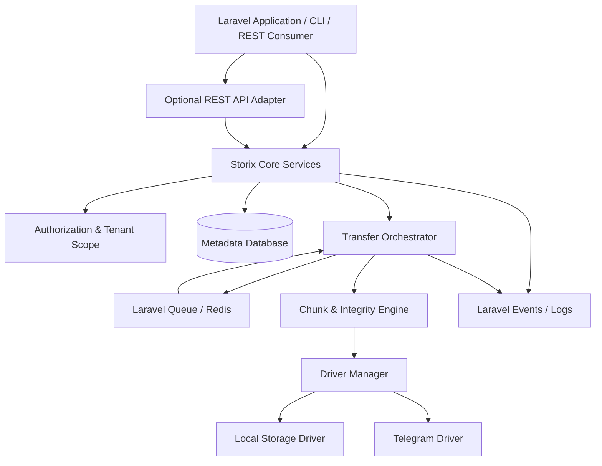
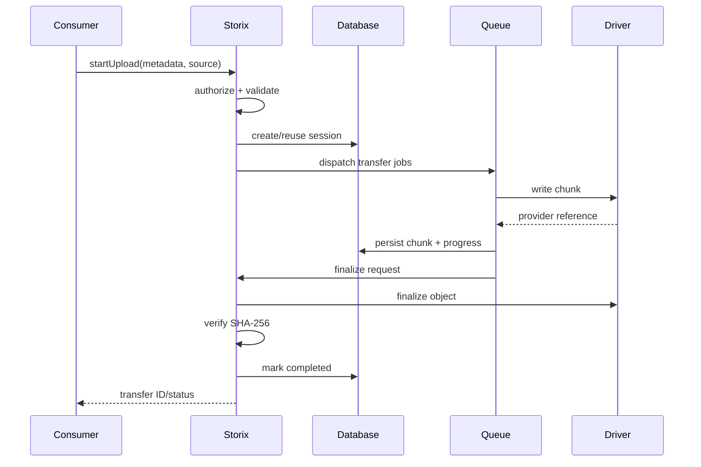

# 02 — System Architecture

## 1. Architectural style

A modular Laravel package with a domain-oriented core, driver ports/adapters, optional REST adapter and queue-based transfer workers.

## 2. Layers

- **Public API:** `Storix` facade and injectable services.
- **Application services:** upload, download, directory, file, transfer and sharing use cases.
- **Domain:** entities, value objects, state machines, policies and exceptions.
- **Contracts:** storage driver, chunk store, progress store, checksum, lock and event abstractions.
- **Infrastructure:** Eloquent persistence, Laravel queue/cache, filesystem and provider clients.
- **Adapters:** optional REST routes/controllers/resources and console commands.

## 3. Upload sequence

## 4. Failure recovery

Every job must be idempotent. Before writing a chunk, inspect durable state and provider capability. After a worker crash, a reconciliation job compares database records with provider references. A chunk is considered complete only if its expected size/hash and provider reference are valid. Retry transient errors; do not retry permanent validation/authorization errors.

Use database transactions for metadata changes, not around slow network I/O. Use a lock keyed by transfer ID/chunk index to prevent concurrent duplicate writes. Use an outbox pattern or after-commit dispatch for reliable event/job publication where needed.

## 5. Idempotency and duplicate detection

Use a client idempotency key for request replay protection. For file matching, calculate a fingerprint from tenant scope, owner scope, file size, normalized target, and a cryptographic content hash when available. Filename alone is never sufficient. If the full hash is unavailable before upload, use a provisional session and reconcile after content is received. Reuse only verified chunks belonging to the same security scope.

## 6. Performance strategy

- Stream from source to destination; avoid loading whole files into PHP memory.
- Use configurable chunk size and bounded concurrency.
- Apply provider-specific concurrency/rate limits.
- Reuse HTTP connections if the provider client supports it.
- Use queue workers for long-running transfers.
- Use temporary files only when required by a driver; enforce disk-space thresholds.
- Keep database progress writes coarse-grained and configurable.
- Measure throughput and tune from benchmarks rather than hard-coded assumptions.

## 7. Consistency rules

- Metadata state is not proof that remote bytes exist; reconcile before finalization.
- `completed` requires driver finalization and integrity success.
- Delete is a two-phase operation: mark deleting, remove provider object, then mark deleted; retry cleanup safely.
- Do not hold database locks while performing network operations.
- A driver capability must explicitly declare whether it supports streaming, native multipart, server-side copy, range reads, pause/resume and atomic finalize.

## 8. Architecture decisions

- Telegram Serverless: excluded.
- Frontend: not part of package; consumer may build any UI.
- REST API: optional adapter; PHP service API is primary.
- Database: Laravel-supported relational database through migrations/Eloquent; avoid assuming Redis is the source of truth.
- Queue: Laravel queue abstraction; Redis recommended for production but not mandatory.
- Driver: replaceable and capability-aware.

---
