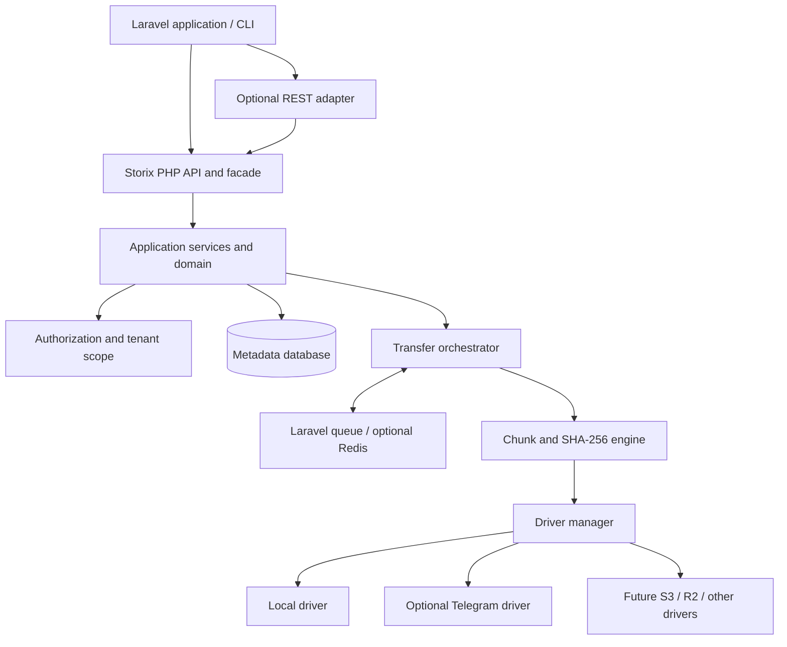

# Storix

<p align="center">
  <strong>One API. Every Storage.</strong><br>
  A driver-based file storage and resilient transfer layer for Laravel.
</p>

<p align="center">
  <a href="https://packagist.org/packages/shamimstack/storix"></a>
  <a href="https://packagist.org/packages/shamimstack/storix"></a>
  <a href="LICENSE"></a>
  <a href="https://github.com/Shamimwhois/storix"></a>
</p>

Storix is an **API-first, backend-only Laravel package** designed to give applications one consistent interface for storing, retrieving, organizing, and transferring files across replaceable storage backends.

Instead of coupling application code to a single provider, Storix places a stable PHP API over a capability-aware driver system. Its engineering design covers streaming I/O, large-file chunking, resumable transfers, retries, integrity verification, transfer observability, and tenant-aware access control.

> **Project status:** E01 Foundation is implemented on the `feature/e01-foundation` branch and its CI checks pass. Storix is not yet a usable storage engine or production release; upload, chunking, drivers, persistence, and transfer features remain on the roadmap.

## At a glance

| | |
|---|---|
| Package | `shamimstack/storix` |
| Namespace | `ShamimStack\\Storix` |
| Product | Storix |
| Tagline | One API. Every Storage. |
| Target runtime | PHP 8.5+ |
| Target framework | Laravel 13.x |
| Architecture | Driver-based, modular, API-first |
| Primary interface | PHP services and facade |
| Optional integration | Versioned REST API adapter |
| Frontend | Not bundled or required |
| License | See [LICENSE](LICENSE) |

## Why Storix?

File storage integrations often leak provider-specific APIs into application code. Large transfers also introduce operational problems: interrupted requests, worker restarts, duplicate submissions, partial writes, provider rate limits, and uncertainty about whether the final bytes are valid.

Storix is designed to centralize those concerns behind a consistent package boundary:

- **One application API:** resolve storage operations through Storix rather than coupling business logic to a provider.
- **Replaceable drivers:** add or change storage backends through contracts and explicit capability declarations.
- **Resilient transfers:** model upload and download as durable workflows, not a single fragile HTTP request.
- **Integrity before success:** verify chunks and final content with SHA-256 where bytes are available.
- **Tenant-aware security:** scope metadata, sessions, and deduplication to the correct owner or tenant.
- **Laravel-native operations:** use Laravel's service container, events, queues, cache, scheduler, filesystem, and migrations where appropriate.

## Planned feature set

### Storage and file management

- Unified file and directory operations.
- Driver registration, resolution, and configuration.
- Stream-based reads and writes to avoid loading entire files into PHP memory.
- File metadata, opaque storage keys, and provider-neutral results.
- Directory creation, listing, rename/move, and safe deletion where supported.
- Driver capability discovery for streaming, range reads, multipart writes, and finalization.
- Extensible architecture for local, Telegram, S3-compatible, Cloudflare R2, and other future backends.

### Upload and download engine

- Small-file and large-file transfer workflows.
- Configurable chunk planning and chunk-size policies.
- Bounded parallel chunk transfer with per-driver and per-tenant limits.
- Durable upload sessions and chunk state.
- Resumable uploads after eligible client, worker, or process interruptions.
- Download streaming and range-based resume when the driver supports it.
- Safe finalization and cleanup of temporary resources.
- Pause, resume, and cancel semantics where the execution mode and driver can support them.

### Reliability and recovery

- Idempotency keys for safe request replay.
- Content fingerprints and duplicate-upload detection within the same security scope.
- Reuse of previously verified chunks only after ownership and integrity checks.
- Transient/permanent error classification.
- Bounded exponential backoff with jitter and provider retry guidance.
- Reconciliation of persisted metadata against actual driver state.
- Stale-session recovery, retention, and cleanup commands.
- No success state until driver finalization and required integrity checks pass.

### Progress and observability

- Transfer state and lifecycle events.
- Total, transferred, and remaining bytes.
- Progress percentage and completed/total chunk counts.
- Current and average throughput measurements.
- Estimated time remaining when sufficient samples exist.
- Attempt counts, timestamps, sanitized error codes, and structured logs.
- Configurable progress persistence to avoid excessive database writes.
- Hooks for notifications, dashboards, and metrics exporters without requiring a bundled UI.

### Security and multi-tenancy

- Host application's Laravel authentication and authorization integration.
- Owner and tenant scoping for files, directories, and transfer sessions.
- Deny-by-default access and protection against IDOR.
- Path normalization and traversal prevention.
- File size, MIME, extension, concurrency, and quota validation.
- Secret redaction and safe provider credential handling.
- SHA-256 integrity verification.
- Optional encryption-at-rest and secure share links subject to explicit release-scope decisions.
- Temporary-file lifecycle and retention controls.

### Laravel integration and developer experience

- Composer package with PSR-4 namespace.
- Laravel service provider and configuration publishing.
- Facade and injectable service APIs.
- Laravel migrations and Eloquent-backed metadata.
- Laravel events and queue-based background processing.
- Optional Redis-backed progress/queue optimizations; relational metadata remains the durable source of truth.
- Optional REST routes, disabled unless configured.
- Unit, integration, driver-contract, security, and performance testing.

## Architecture

Storix follows a modular, domain-oriented architecture. The public PHP API delegates to application services; domain logic depends on contracts rather than provider SDKs. Infrastructure adapters implement those contracts.



**Core design rule:** the transfer engine must adapt to declared driver capabilities. Not every backend supports multipart writes, range reads, atomic finalization, or identical pause/resume behavior.

## Example API direction

The following is illustrative usage to communicate the intended developer experience. Exact method signatures and DTOs will be finalized during implementation; this is not a claim that the API is currently available.

```php
use ShamimStack\\Storix\\Facades\\Storix;

// Store a file through the configured default driver.
$file = Storix::files()->put(
    source: $uploadedFile,
    directory: 'invoices/2026',
    options: ['visibility' => 'private'],
);

// Read as a stream instead of loading the whole object into memory.
$stream = Storix::files()->readStream($file->id);

// Start a transfer and inspect its durable status.
$transfer = Storix::uploads()->start($source, [
    'directory' => 'backups',
    'idempotency_key' => $requestId,
]);

$status = Storix::transfers()->status($transfer->id);
```

## Storage driver strategy

| Driver | Role | Status / boundary |
|---|---|---|
| Local | Baseline filesystem-backed storage | Planned first usable driver |
| Telegram | Optional remote storage integration | Planned; must revalidate official API limits, policy, and deployment constraints |
| S3-compatible | Object storage integration | Future extension |
| Cloudflare R2 | S3-compatible backend candidate | Future extension |
| Custom driver | Application/vendor-specific backend | Enabled by the driver contract design |

Telegram is an optional driver, not Storix's identity or only backend. **Telegram Serverless is explicitly out of scope.** Provider limits and permitted usage must be checked against current official documentation before implementation and release.

## Installation

Storix is intended to be distributed as a Composer package. Once a compatible release is published, the expected installation command is:

```bash
composer require shamimstack/storix
```

> Until a tagged release is available on Packagist, this command is an installation target, not a guarantee that a published package exists. For development, follow the repository's implementation instructions and Composer path/VCS setup.

## Documentation portal stack

The live documentation website is published at **[Storix Documentation](https://shamimwhois.github.io/storix/)**. Its source is [docs/index.html](docs/index.html), and the portal is built with:

- Tailwind CSS v4 — compiled production CSS (no Tailwind runtime CDN).
- Alpine.js 3 — navigation, search, theme toggle, and small UI interactions.
- esbuild — bundles the Alpine application into a static JavaScript asset.
- GitHub Actions — builds and deploys the static portal to GitHub Pages on changes to `main`.

To build the portal locally:

```bash
cd docs
npm install
npm run build
```

The build writes `docs/assets/app.css` and `docs/assets/app.js`. The GitHub Pages workflow publishes the compiled site artifact; generated dependencies are not included in the published website.

## Documentation

The documentation portal is available at **[docs/index.html](docs/index.html)**.

| Document | Description |
|---|---|
| [Product requirements](docs/01-product-requirements.md) | Goals, scope, requirements, user journeys, and acceptance criteria |
| [System architecture](docs/02-system-architecture.md) | Layers, data flow, failure recovery, consistency, and architecture rules |
| [Database design](docs/03-database-design.md) | Metadata schema, relationships, indexes, and state persistence |
| [Package structure](docs/04-package-structure.md) | Composer layout and class responsibilities |
| [Core PHP and REST API](docs/05-core-api-and-rest-api.md) | API direction, optional routes, response and error contracts |
| [Transfer engine](docs/06-transfer-engine.md) | Chunking, retry, resume, progress, concurrency, and downloads |
| [Storage drivers](docs/07-storage-drivers.md) | Driver contract, capabilities, local and Telegram integration boundaries |
| [Security design](docs/08-security-design.md) | Threat model, authorization, tenant isolation, secrets, and integrity |
| [Testing strategy](docs/09-testing-strategy.md) | Unit, integration, contract, security, and performance validation |
| [Implementation roadmap](docs/10-implementation-roadmap.md) | Fourteen implementation epics and dependencies |
| [AI coding instructions](docs/11-ai-coding-instructions.md) | Repository workflow and implementation constraints |
| [Configuration and operations](docs/12-configuration-and-operations.md) | Configuration, queues, scheduler, observability, and troubleshooting |
| [Acceptance checklist](docs/13-acceptance-checklist.md) | Evidence-based release and production-readiness gates |
| [Architecture decisions](docs/DECISIONS.md) | Confirmed decisions and unresolved engineering choices |

## Implementation roadmap

Implementation is staged to reduce architectural risk:

1. **E01 — Foundation:** Composer metadata, service provider, configuration, CI, and package conventions.
2. **E02 — Contracts and API:** typed DTOs, exceptions, driver contracts, facade, and service bindings.
3. **E03 — Persistence:** migrations, models, repositories, and transfer state machine.
4. **E04 — Local driver:** safe stream-based local storage.
5. **E05 — Basic upload:** validation, upload records, finalization, and checksum.
6. **E06 — Chunk engine:** deterministic chunk planning and bounded concurrency.
7. **E07 — Resume and idempotency:** fingerprinting and safe reconciliation.
8. **E08 — Recovery and retry:** locks, backoff, and cleanup.
9. **E09 — Download engine:** streaming, range support, and integrity.
10. **E10 — Progress and events:** observable transfer lifecycle.
11. **E11 — Performance:** benchmarks, quotas, and tuning.
12. **E12 — Telegram driver:** only after current provider constraints are verified.
13. **E13 — REST adapter and security:** optional HTTP integration and security hardening.
14. **E14 — Release and operations:** compatibility matrix, docs, CI, and release gates.

A foundation milestone is not a production transfer engine. The roadmap defines the minimum evidence for each release stage.

## Compatibility targets

- PHP 8.5+
- Laravel 13.x
- Laravel-supported relational database through migrations/Eloquent
- Laravel queue abstraction; Redis is recommended for production workloads but is not mandatory
- No frontend framework dependency

These are the project's current target constraints. The supported matrix must be confirmed by CI before each release.

## Development principles

1. Keep provider-specific SDK types out of the domain layer.
2. Use streaming I/O and bounded concurrency.
3. Treat metadata as a record of state, not proof that remote bytes exist.
4. Make jobs and retries idempotent.
5. Scope file access and deduplication to the same tenant/security boundary.
6. Never expose credentials, private storage references, or raw exception traces.
7. Test failure paths, not only happy paths.
8. Mark features complete only when code and automated/operational evidence exist.
9. Do not claim guaranteed speed, unlimited size, or zero failures.
10. Update documentation and acceptance evidence alongside implementation.

## Contributing

Contributions should follow the architecture, coding instructions, and roadmap in the [documentation](docs/index.html). Before opening a pull request:

- inspect the relevant epic and its dependencies;
- keep changes within the selected scope;
- add or update tests for behavior and failure paths;
- run the available formatter, static analysis, and test suite;
- document compatibility or behavior changes;
- do not mark planned capabilities complete without evidence.

## Security

Do not commit bot tokens, cloud credentials, signed URLs, private storage references, or user data. Report suspected vulnerabilities privately to the repository maintainer rather than publishing exploit details in an issue.

## License

The repository's license governs use and distribution. See [LICENSE](LICENSE) when present.
