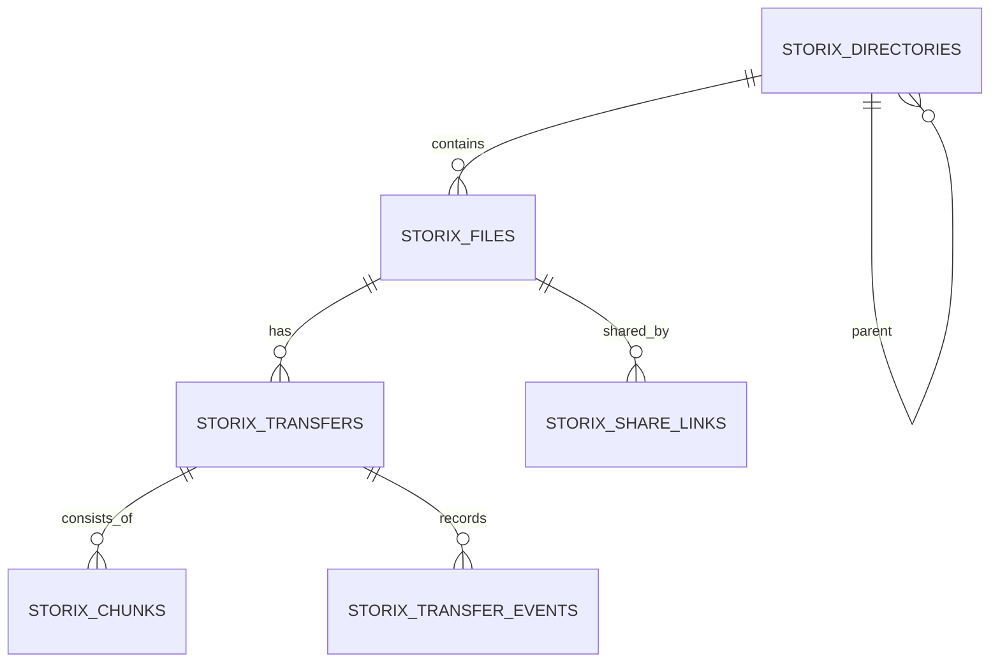

# 03 — Database Design

## 1. Principles

Use UUID primary keys consistently for Storix-owned records; never expose sequential database IDs. E03 does not mix UUID and ULID. Store sizes as unsigned big integers. Store timestamps in UTC. Add nullable `tenant_id` and `owner_id` `varchar(64)` scope identifiers without foreign keys to host-application identity tables; this avoids assuming a host app's primary-key type. Avoid storing credentials or encryption keys in plaintext.

## 2. Tables

### `storix_directories`
- `id` UUID/ULID primary key
- `tenant_id` varchar(64) nullable indexed
- `owner_id` varchar(64) nullable indexed
- `parent_id` nullable FK to directories
- `name` varchar(255)
- `path_key` varchar(1024) normalized path
- `driver` varchar(64)
- `status` varchar(24): active/deleting/deleted
- timestamps, soft delete timestamp
- composite lookup index on `(tenant_id, owner_id, driver, parent_id, name)`; atomic directory-name uniqueness is deferred to the directory service.

### `storix_files`
- `id` UUID/ULID primary key
- `tenant_id`, `owner_id` nullable `varchar(64)` scope fields; `directory_id` nullable FK
- `driver` varchar(64)
- `name`, `original_name`, `extension`, `mime_type`
- `size_bytes` unsigned bigint
- `sha256` char(64), nullable until verified
- `storage_key` text; provider reference must not be treated as public URL
- `status`: pending/processing/available/deleting/deleted/failed
- `visibility`: private/public/limited
- `metadata` JSON nullable
- timestamps, soft delete timestamp
- indexes: scoped owner/tenant creation order, directory, driver+status, and scoped checksum lookup.

### `storix_transfers`
- `id` UUID/ULID primary key
- `file_id` nullable FK
- `tenant_id`, `owner_id`
- `direction`: upload/download
- `driver`
- `state`: pending/preparing/transferring/paused/retry_wait/verifying/completed/failed/cancelled/expired
- `source_name`, `total_bytes`, `transferred_bytes`
- `total_chunks`, `completed_chunks`
- `average_bytes_per_second`, `eta_seconds` nullable
- `idempotency_key` nullable
- `fingerprint` nullable
- `attempts`, `max_attempts`
- `last_error_code`, `last_error_message` sanitized
- `started_at`, `finished_at`, `expires_at`
- timestamps
- unique `(idempotency_scope, idempotency_key)` when key is non-null; `idempotency_scope` is a SHA-256 hash of the normalized tenant/owner pair so nullable identity columns cannot weaken uniqueness. Empty/whitespace-only keys are rejected.

### `storix_chunks`
- `id` UUID/ULID
- `transfer_id` FK
- `chunk_index` unsigned integer
- `offset_bytes`, `size_bytes`
- `sha256` char(64)
- `state`: pending/uploading/verified/failed
- `driver_reference` text nullable
- `attempts`, `last_error_code`
- timestamps
- unique `(transfer_id, chunk_index)`; index `(transfer_id, state)`.

### `storix_share_links` (deferred optional module)
- `id` UUID/ULID
- `file_id` FK
- `token_hash` char(64), unique
- `expires_at`, `max_downloads`, `download_count`
- `password_hash` nullable
- `revoked_at`, `created_by`
- timestamps
Store only a hash of the share token; return the raw token once at creation.

### `storix_transfer_events` (deferred optional audit/history)
- `id`, `transfer_id`, `event_type`, `payload` JSON, `occurred_at`
- index `(transfer_id, occurred_at)`.

## 3. Relationships

## 4. State constraints

A transfer may become `completed` only from `verifying`. A terminal transfer cannot return to `transferring`; create a new transfer or an explicitly supported recovery attempt. Chunk `verified` requires size and hash verification. Use service-level transition validation and database constraints where portable.

## 5. Migration and indexing notes

- Add foreign keys and cascade behavior deliberately; prefer restrictive deletes for audit-sensitive records.
- Use composite indexes matching actual query filters.
- JSON columns are for non-critical extensible metadata, not core query fields.
- E03 initially validates SQLite through Testbench; do not claim MySQL/PostgreSQL support until those engines are included in CI.
- Host `tenant_id` and `owner_id` values are stored as strings (64 characters max), with no host-table foreign keys.
- See [E03 Persistence specification](16-e03-persistence.md) for the implementation-ready schema, repository boundaries, and state machine.
- If cross-database partial unique indexes differ, enforce idempotency in a transaction with a unique key strategy compatible with the supported engines.

---
