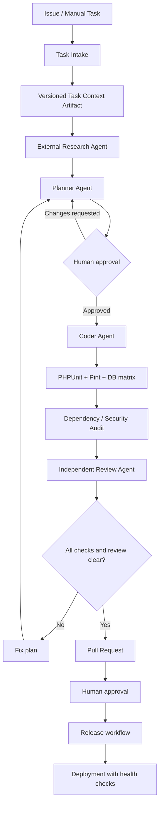

# Storix Autonomous Engineering & CI Control Plane

## Purpose

This repository now contains the CI foundation and a safe task-intake contract for an Autonomous Engineering control plane. The dashboard shown in the product concept is a **separate application**; Storix remains a backend-only Composer package.

The repository integration is intentionally staged:

1. GitHub Actions validates code and dependencies.
2. Issues can be opted into agent task intake with the `ai-task` label.
3. A workflow produces a versioned task-context artifact.
4. An external agent runner may consume that artifact after it has been explicitly configured.
5. Human review remains mandatory before repository writes, merges, or deployments.

**Important:** task intake is not an AI coding agent. This workflow does not call an LLM, modify source files, push branches, approve PRs, merge code, or deploy. Those capabilities require a separately provisioned runner, provider credentials, narrowly scoped GitHub App permissions, and explicit approval policy.

## Repository workflow map

| Workflow | Trigger | Responsibility |
|---|---|---|
| `Storix CI` | Push, PR to `main` or `feature/**`, manual | Composer validation, PHP 8.5 setup, Pint, PHPUnit on SQLite/MySQL 8.4/PostgreSQL 17 |
| `Dependency security audit` | Same CI workflow | Resolve a temporary dependency graph for this library (no committed lockfile), then run `composer audit --locked` against that generated lockfile. The lockfile is CI-local and is not committed. |
| `Autonomous Engineering — Task Intake` | Issue receives `ai-task`, or manual dispatch | Validate issue and publish a task-context artifact |

## Pipeline stages

The Research, Planner, Coder, Tester, Security, Review, and Release agents are integration roles, not active GitHub-hosted agents in this repository yet. Their runtime is supplied by the future control-plane service.

## Task intake

### Label-triggered intake

1. Create a GitHub Issue using the AI Task template.
2. Add the `ai-task` label.
3. The workflow validates the issue and creates `storix-agent-task-<issue-number>`.
4. Download `task-context.json` from the workflow run artifact.

### Manual intake

Run **Actions → Autonomous Engineering — Task Intake → Run workflow** and provide an issue number plus a requested mode:

- `ask` — prepare context for an interactive agent session.
- `plan` — prepare context for planning.
- `auto` — record an auto-mode request only; this does not grant write permission or bypass human approval.

The artifact includes repository, issue metadata, requested mode, default branch, schema version, and explicit safety flags.

## Agent runner integration contract

The future external runner should:

- Accept only the versioned task artifact and fetch additional repository context read-only.
- Use a dedicated GitHub App installation, not a personal access token.
- Separate read-only planning from write-capable implementation.
- Create a feature branch and draft PR; never push to `main`.
- Run the same CI matrix and security checks before requesting review.
- Store execution state, agent identity, model/provider, tool calls, changed paths, and approvals in an auditable task record.
- Resume long-running tasks independently of the browser session.
- Enforce per-task budgets, timeouts, concurrency limits, path restrictions, and secret redaction.
- Stop and request human approval for destructive operations, dependency/license changes, migrations, credential access, merge, and deployment.

Do not expose provider API keys in workflow artifacts, issue comments, logs, or task JSON.

## Dashboard data contract

A separate dashboard can derive initial live data from GitHub:

| Dashboard panel | Source |
|---|---|
| Active tasks / Kanban | Issues, labels, Projects, task artifacts |
| Development pipeline | Task status events and PR checks |
| Agent collaboration graph | External runner agent/task event stream |
| Execution logs | Runner event store; GitHub Actions logs for CI |
| Success rate | Completed tasks with accepted PRs / completed tasks |
| Parallel jobs | Active runner jobs and GitHub Actions jobs |
| Pipeline health | Required check conclusions and runner heartbeat |

Do not infer agent activity from GitHub Actions job count. Agent runtime telemetry must come from the external runner.

## Required GitHub setup

- Create the `ai-task` label.
- Configure branch protection/rulesets for `main` and require CI checks.
- Keep GitHub Actions permissions read-only by default.
- Add an environment with required reviewers before any future release/deployment workflow.
- Configure a dedicated GitHub App for the future runner with the minimum permissions needed.
- Store provider credentials only in the runner's secret manager or GitHub Actions secrets where strictly required.

## Rollout milestones

| Milestone | Scope | Status |
|---|---|---|
| AE-01 | CI matrix for stacked PR targets and Composer dependency audit | Implemented in this branch; CI pending |
| AE-02 | Issue template and safe task-context artifact workflow | Implemented in this branch; CI pending |
| AE-03 | External agent runner contract and event persistence | Documented; not implemented |
| AE-04 | Standalone dashboard with live pipeline and agent graph | Planned |
| AE-05 | Permission modes, approvals, GitHub App write integration | Planned; requires explicit security review |
| AE-06 | Release/deployment automation and health-check recovery | Planned; no deployment enabled |

## Security boundary

The task-intake workflow is deliberately non-mutating with respect to source code. It comments on the opted-in issue and uploads a short-lived task context artifact only. It does not install or execute untrusted issue-provided code. Do not add automatic repository write permissions until the external runner has been threat-modelled and its approval gates are tested.
