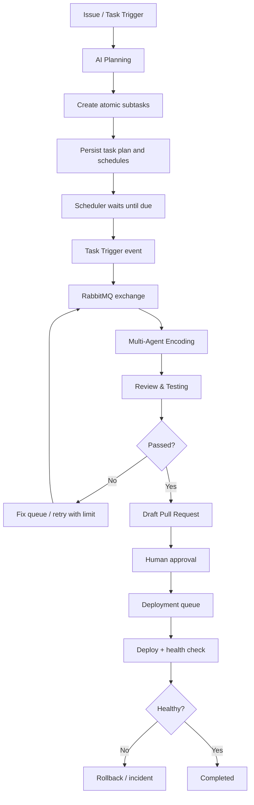

# Scheduled Autonomous Engineering Pipeline

## Desired lifecycle

The intended pipeline is event-driven and schedule-aware:

AI Planning creates a parent task and small, independently executable child tasks. Each child task carries dependencies, priority, estimate, retry policy, due time, and an idempotency key. The scheduler emits a task-ready event only after the due time and dependency conditions are satisfied.

## Components and responsibilities

| Component | Responsibility |
|---|---|
| Task Trigger | Accept issue, manual, API, and scheduled events |
| AI Planner | Research, create plan, split work into atomic tasks, define dependencies |
| Plan Store | Persist parent/child tasks, schedules, status, approvals and audit trail |
| Scheduler | Find due tasks, enforce dependency ordering, emit exactly-once-effect events |
| RabbitMQ | Durable task transport, routing, retries, dead-lettering and worker backpressure |
| Multi-Agent Encoding | Research, architecture, coding and implementation agents |
| Review & Testing | PHPUnit, Pint, database matrix, static/security checks and independent review |
| Fix Queue | Requeue bounded remediation tasks when checks fail |
| Release Gate | Require passing checks and human approval |
| Deployment Controller | Deploy immutable artifact, verify health and execute rollback policy |

## RabbitMQ topology

Use durable quorum queues for critical work. The application/control plane owns RabbitMQ connections; GitHub Actions does not connect to AMQP directly.

| Exchange | Type | Routing keys |
|---|---|---|
| `storix.tasks` | topic | `task.ready`, `task.scheduled`, `task.cancelled` |
| `storix.agents` | topic | `agent.research`, `agent.plan`, `agent.code`, `agent.test`, `agent.review` |
| `storix.reviews` | topic | `review.requested`, `review.passed`, `review.failed` |
| `storix.deployments` | topic | `deploy.requested`, `deploy.succeeded`, `deploy.failed`, `deploy.rollback` |
| `storix.dead-letter` | direct | `dead` |

Recommended queues:

- `storix.task-trigger`
- `storix.agent.research`
- `storix.agent.planning`
- `storix.agent.encoding`
- `storix.review.testing`
- `storix.fix.retry`
- `storix.deployment.approval`
- `storix.dead-letter`

Use publisher confirms, manual consumer acknowledgements, bounded prefetch, durable messages, quorum queues, dead-letter routing, and an outbox pattern. Consumers must be idempotent. Acknowledge only after durable state transitions. Do not rely on RabbitMQ message TTL as the sole task scheduler; persist `run_at` in the plan store and let a scheduler publish due tasks. Delayed exchange plugin is optional, not a correctness dependency.

## Task plan and schedule contract

Each planned task should include:

- `schema_version`
- `task_id`, `parent_task_id`, `idempotency_key`
- `title`, `description`, `acceptance_criteria`
- `depends_on[]`, `priority`, `assigned_agent_role`
- `run_at` (UTC ISO-8601), `deadline_at`, `timeout_seconds`
- `max_attempts`, `retry_backoff_seconds`
- `status`, `created_at`, `updated_at`
- `approval_required`, `write_scope`, `allowed_paths[]`

The planner must not schedule a child before all dependencies are complete. Persist schedule state in the database; RabbitMQ carries wake-up events, not the source of truth.

## Event lifecycle

1. Task Trigger creates a parent task and emits `task.created`.
2. AI Planner returns a validated plan; plan store persists parent and child tasks.
3. Scheduler claims due tasks transactionally and emits `task.scheduled` with a stable idempotency key.
4. RabbitMQ routes tasks to role-specific workers. Each worker emits started/progress/completed/failed events.
5. The orchestration service waits for required coding subtasks and submits the change for review.
6. Review & Testing runs package CI and independent review. Failed checks create bounded fix tasks; exhausted retries enter dead-letter and require human intervention.
7. Passing work creates/updates a draft PR. Merge is still a separate human approval.
8. Deployment is a separate protected environment operation with immutable ref, health verification and rollback plan.

## Repository integrations added

### RabbitMQ bridge

`.github/workflows/autonomous-pipeline.yml` accepts authenticated `repository_dispatch` events or manual dispatch and forwards validated, idempotent event envelopes to the external control plane at:

`POST {STORIX_AGENT_RUNNER_URL}/v1/github/events`

Configure repository variable `STORIX_AGENT_RUNNER_URL` and secret `STORIX_AGENT_RUNNER_TOKEN`. The endpoint must validate the token, deduplicate `delivery_id`, persist the event, and publish the corresponding message to RabbitMQ. GitHub Actions never receives RabbitMQ credentials.

Supported event types:

- `storix.task.scheduled`
- `storix.task.ready`
- `storix.agent.stage.completed`
- `storix.review.requested`

The external scheduler/runner is responsible for creating the scheduled event when `run_at` is due. GitHub Actions is an authenticated relay, not the scheduler or agent runtime.

### Deployment gate

`.github/workflows/autonomous-deploy.yml` is a manual deployment request gate. Configure protected GitHub environments named `staging` and `production`, with required reviewers especially for production. Configure `STORIX_DEPLOY_RUNNER_URL` and `STORIX_DEPLOY_RUNNER_TOKEN` in the appropriate repository/environment scopes.

The deployment controller endpoint must enforce approval, immutable artifact provenance, health checks and rollback. The workflow does not deploy directly and fails closed if configuration is missing.

## Required secrets and variables

| Name | Type | Purpose |
|---|---|---|
| `STORIX_AGENT_RUNNER_URL` | Repository variable | HTTPS control-plane endpoint |
| `STORIX_AGENT_RUNNER_TOKEN` | Repository secret | Authenticate event relay |
| `STORIX_DEPLOY_RUNNER_URL` | Environment variable | HTTPS deployment controller |
| `STORIX_DEPLOY_RUNNER_TOKEN` | Environment secret | Authenticate deployment request |

Never put RabbitMQ username/password or LLM provider keys in issue content, workflow artifacts, or event payloads. Store broker credentials and model provider keys only in the external control plane's secret manager.

## Operational policies

- At-least-once delivery with idempotent consumers; do not claim broker-level exactly-once execution.
- Per-task and per-agent concurrency limits; fair dispatch by priority and due time.
- Exponential backoff with jitter and bounded retries.
- Dead-letter exhausted or malformed messages; alert and require human triage.
- Persist every state transition before acknowledging a message.
- Enforce task lease/heartbeat and recover expired leases.
- Never let the planner grant its own elevated permissions.
- Require human approval for protected path changes, dependency upgrades, migrations, merge and production deployment.
- Cancellation must revoke task leases and prevent queued work from starting.
- Keep full audit events, redact secrets, and set retention limits.

## Current implementation boundary

Implemented in this repository branch:

- GitHub Actions relay for scheduled/ready/review events.
- Validated event envelope and idempotency key.
- Manual, protected-environment deployment request gate.
- Documented RabbitMQ topology, task plan contract, scheduler and worker lifecycle.

Still requires an external control-plane service:

- LLM-backed planning and task decomposition.
- Persistent plan store and scheduler.
- RabbitMQ broker, exchanges, queues and consumers.
- Multi-agent execution runtime and live agent telemetry.
- Review orchestration beyond repository CI.
- Deployment controller, credentials, health checks and rollback implementation.

No production deployment is enabled by this change. The external service must be provisioned and security-reviewed before agent execution is turned on.
